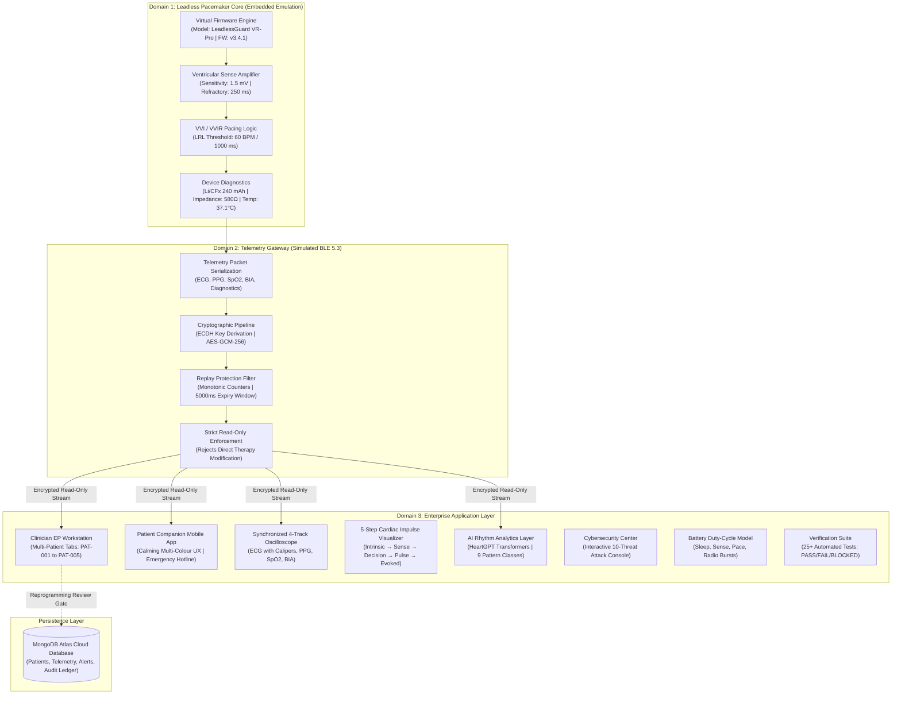

# HealthHeart™ | LeadlessGuard™ System Architecture Document
**Classification:** `SIMULATION` / `MONITORING` / `RESEARCH ONLY`

---

## 1. Executive Summary & Purpose
HealthHeart™ / LeadlessGuard™ is an enterprise-grade cardiac telemetry and electrophysiology research platform modeling a smartphone-integrated intelligent leadless pacemaker. 

> **Important Safety Boundary:**
> This system is an engineering simulation platform for digital health research, cybersecurity analysis, and electrophysiological concept demonstration. It contains **no real therapeutic device commands, implant firmware, clinical programmer protocols, or physical BLE characteristics capable of pacing a human heart**. Real implanted pacemaker programming is outside the scope of this prototype.

---

## 2. End-to-End System Architecture

---

## 3. High-Level Subsystem Specifications

| Subsystem | Functional Scope | Primary Technology |
| :--- | :--- | :--- |
| **Leadless Pacemaker Core** | Deterministic VVI/VVIR pacing threshold mathematics, escape interval calculation, intrinsic sensing blanking, battery discharge estimation. | TypeScript / Deterministic Mathematical Models |
| **Telemetry Gateway** | Read-only packet serialization, BLE 5.3 GATT framing emulation, simulated ECDH key exchange, HKDF session keys, AES-GCM-256 authenticated encryption. | TypeScript / Node.js Express Gateway |
| **Clinician EP Command Workstation** | 12 operational views, 5-patient tab switching, calibrated HTML5 Canvas ECG ($25\text{ mm/s}, 10\text{ mm/mV}$), digital calipers, alert lifecycle. | React 18 / TypeScript / Vite |
| **Patient Companion Mobile App** | Calming, reassuring patient interface, pulsing radial heart container, SpO2 quality badge, live pulse strip, tri-colour SVG activity rings, emergency call. | React 18 / SVG / CSS3 Animations |
| **Persistence Layer** | Secure cloud storage for patient baseline profiles, continuous telemetry frames, clinical alerts, and SHA-256 tamper-evident audit ledger. | MongoDB Atlas (`cluster0.sjdskjp.mongodb.net`) |
