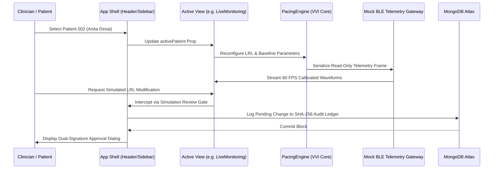

# HealthHeart™ | LeadlessGuard™ Software Architecture Document
**Classification:** `SIMULATION` / `MONITORING` / `ANALYTICS`

---

## 1. Modular Directory Structure

```
e:\Health
├── docs/                        # Complete 20 Technical Documents Suite
├── server/                      # Node.js + Express + TypeScript Backend
│   ├── src/
│   │   ├── config/              # MongoDB Atlas Connection (Mongoose)
│   │   ├── models/              # Patient, Telemetry, Alert, Audit, Scenario Schemas
│   │   ├── routes/              # Express REST Endpoints
│   │   ├── seed.ts              # Canonical Patient & Alert Seeding
│   │   └── server.ts            # HTTP API Gateway (Port 5000)
├── src/                         # React 18 + Vite + TypeScript Frontend
│   ├── components/
│   │   ├── CardiacImpulsePanel.tsx   # 5-Step Animated Pacing Decision Pipeline
│   │   ├── ECGCanvas.tsx             # 60 FPS Canvas with Calibrated Calipers
│   │   ├── FaultInjectionPanel.tsx   # Sensor Fault & SQI Degradation Console
│   │   ├── Header.tsx                # Role & Mobile Viewport Mockup Toggles
│   │   ├── Sidebar.tsx               # Deep Navy Multi-Tab Navigation
│   │   └── ViewportFrame.tsx         # 390x844px iPhone Frame Container
│   ├── panels/
│   │   ├── admin/
│   │   │   ├── AdminDashboard.tsx       # Command Center & Multi-Patient Tabs
│   │   │   ├── AiAnalyticsView.tsx      # 9-Class Rhythm Pattern Classifier
│   │   │   ├── BatteryModelView.tsx     # Duty-Cycle Longevity Simulator
│   │   │   ├── DataImportView.tsx       # PhysioNet MIT-BIH Loader
│   │   │   ├── LiveMonitoringView.tsx   # Synchronized 4-Track Oscilloscope
│   │   │   ├── ReportsView.tsx          # SHA-256 Tamper-Evident Ledger
│   │   │   ├── ResearchWorkspaceView.tsx# HeartGPT Lab & 8 Scenarios Runner
│   │   │   ├── SecurityCenterView.tsx   # Mock BLE & 10-Threat Attack Console
│   │   │   ├── SettingsView.tsx         # Reprogramming Gate & DB Status
│   │   │   ├── TrendsAnalyticsView.tsx  # Longitudinal 1h-30d HRV Trends
│   │   │   └── VerificationSuiteView.tsx# 25+ Automated Tests Dashboard
│   │   └── user/
│   │       └── PatientCompanionView.tsx # Photo-Matched Calming Patient App
│   ├── services/
│   │   ├── api.ts                    # REST Client with Failover Fallbacks
│   │   ├── heartgptLab.ts            # Tokenizer, Attention, Homonym Models
│   │   ├── pacingEngine.ts           # Deterministic VVI Pacing Logic Core
│   │   └── signalGenerators.ts       # Mathematical Biosignal Synthesizer
│   ├── types/
│   │   └── index.ts                  # Strongly Typed Domain Interfaces
│   ├── App.tsx                       # Main Application Orchestrator
│   └── index.css                     # Medical Multi-Colour Visual System
```

---

## 2. Component Interaction & State Model


