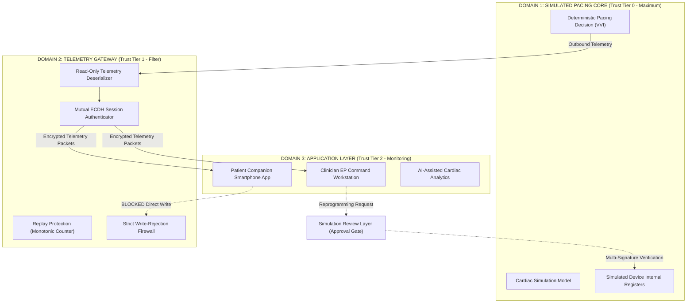

# HealthHeart™ | LeadlessGuard™ Three-Domain Trust Boundary Specification
**Classification:** `SECURITY` / `SIMULATION`

---

## 1. Trust Domain Boundary Isolation

---

## 2. 4-Tier Role Authorization Matrix

| Role | Telemetry Monitoring | Scenario Benchmarks | Simulated Reprogramming | Security Attack Testing |
| :--- | :---: | :---: | :---: | :---: |
| **Viewer** | Read-Only | Denied | Denied | Denied |
| **Researcher** | Read-Only | Full Access | Denied | Denied |
| **Clinician-Simulation** | Read-Only | Full Access | Requires Dual Approval | Denied |
| **Administrator** | Full Access | Full Access | Authorized | Full 10-Threat Console |

---

## 3. Reprogramming Review Gate Workflow
1. User with `Clinician-Simulation` requests modification of Lower Rate Limit ($LRL$) from $60\text{ BPM}$ to $70\text{ BPM}$.
2. Gateway intercepts request; direct write is rejected.
3. Review layer prompts for requesting clinician ID, timestamp, and clinical rationale.
4. Authorization committed to append-only SHA-256 audit ledger in MongoDB Atlas.
5. Parameter updated strictly within virtual emulation registers.
