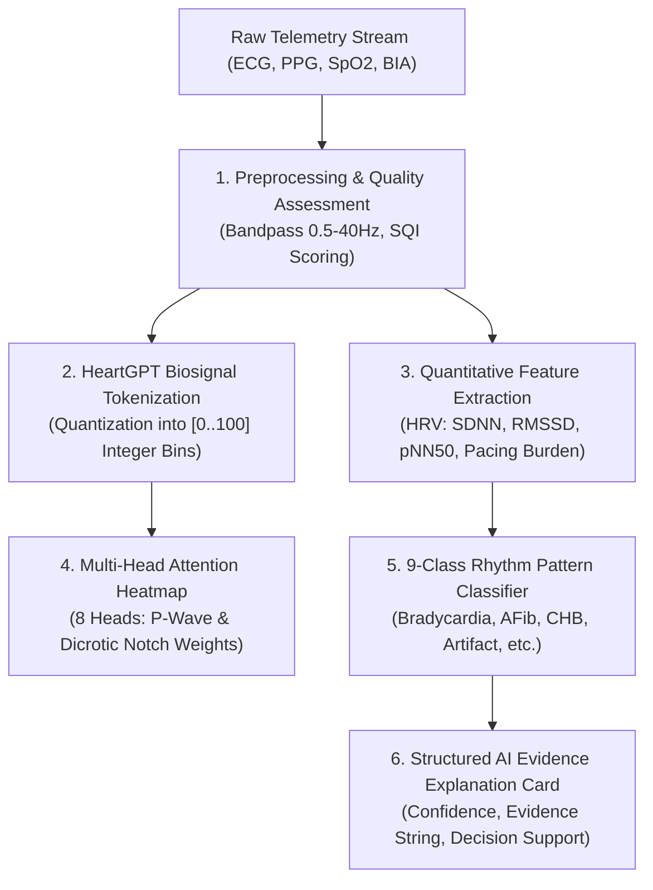

# HealthHeart™ | LeadlessGuard™ AI Analytics Pipeline Document
**Classification:** `ANALYTICS` / `RESEARCH ONLY`

---

## 1. Multi-Stage Pipeline Architecture

---

## 2. HeartGPT Interpretability Lab Integration
- **Tokenization:** Min-max scaling into 101 discrete tokens ($[0..100]$) inspired by natural language processing architectures.
- **Cardiac Homonyms:** Disambiguates identical voltage amplitudes occurring during systole vs diastole using 2D PCA phase-space projection.
- **Safety Restriction:** AI output is strictly decision-support. It possesses **zero write permissions** to pacing parameters.
